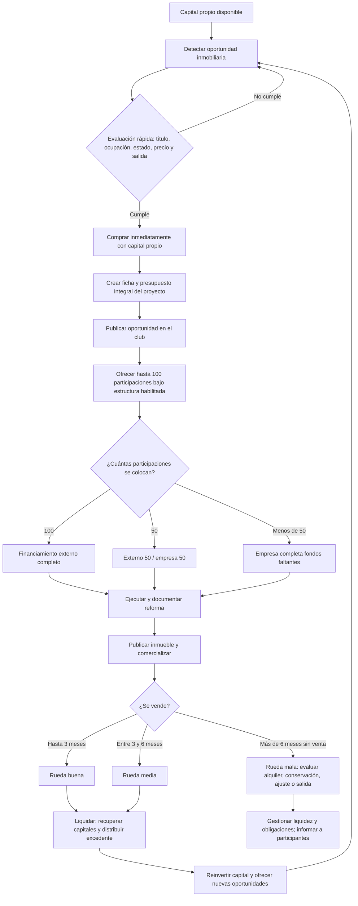
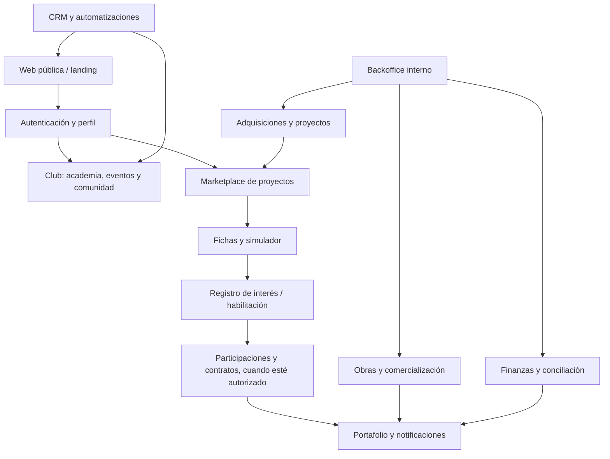

# Club de Inversión Inmobiliaria — Modelo de negocio maestro

> **Estado:** documento estratégico de trabajo, versión 1.0 — noviembre de 2026.  
> **Mercado inicial:** Venezuela.  
> **Nombre comercial:** por definir.  
> **Convención:** «Definido» = decisión expresada en la conversación; «Hipótesis» = propuesta pendiente de validar.

## 1. Resumen ejecutivo

La empresa adquiere inmuebles con **capital propio y capacidad de cierre rápido**, los recupera mediante reformas y los comercializa. Una comunidad digital —posicionada como **club de inversión inmobiliaria**, con registro gratuito y acceso sencillo— permite a inversionistas participar económicamente en **los resultados de cada operación inmobiliaria**, sin adquirir titularidad legal sobre el inmueble.

El financiamiento externo sirve para **ampliar la liquidez y el número de operaciones simultáneas**, no para condicionar la compra: la empresa compra con recursos propios y, si es necesario, puede financiar las reformas por sí misma. La plataforma digital reúne captación, educación, información de proyectos, registro de participaciones, seguimiento de obras, resultados y reinversión.

**Objetivo económico:** recuperar y rotar rápidamente el capital de compra; cobrar honorarios legítimos por gestionar y ejecutar reformas; y capturar una parte mayoritaria del excedente inmobiliario. El sistema de inversionistas es un motor de escalabilidad y el club puede evolucionar hacia membresías premium de educación y comunidad.

## 2. Tesis y propuesta de valor

### Para la empresa
- Comprar inmediatamente con capital propio para negociar mejores precios y no esperar rondas de financiamiento.
- Estandarizar compras, presupuestos, obras y ventas para reducir costos y tiempo.
- Financiar parte o la totalidad del presupuesto integral de recuperación mediante participaciones externas.
- Capturar ingresos por gestión de reformas y por el resultado inmobiliario; reinvertir el capital recuperado.

### Para el inversionista
- Acceder a operaciones inmobiliarias por montos pequeños (ejemplo inicial: **USD 100 por participación**).
- Participar en el **excedente de la operación completa**, no solamente en los honorarios de reforma.
- Consultar información del activo, presupuesto, escenarios, riesgos, avance de obra y comercialización.
- Participar en una comunidad con charlas, formación, encuentros y seguimiento de proyectos.

**Importante:** no se promete rentabilidad fija ni fecha cierta de liquidación; la rentabilidad depende del resultado realizado y los contratos aplicables. La inversión puede sufrir pérdidas.

## 3. Actores y responsabilidades

| Actor | Función |
|---|---|
| Empresa operadora | Compra y mantiene la propiedad legal del inmueble; dirige el proyecto y la comercialización. |
| Unidad de reformas | Presupuesta, contrata y supervisa obras; factura honorarios definidos y transparentes. Puede ser interna o contratada. |
| Inversionistas | Aportan capital y adquieren derechos económicos contractuales sobre un proyecto, sin adquirir la titularidad del inmueble. |
| Club digital | Captación, registro, educación, presentación de oportunidades, seguimiento y relación con miembros. |
| Asesores/proveedores | Due diligence, valuación, contratistas, comercialización, contabilidad y cumplimiento. |

La denominación «acciones» se usa informalmente en la idea original. En producto y documentación formal se recomienda hablar provisionalmente de **participaciones económicas por proyecto**, hasta definir su instrumento jurídico.

## 4. Recorrido completo de una operación

### Clasificación de ruedas (definido)
- **Buena:** compra, reforma y venta completadas en **hasta tres meses**.
- **Media:** cierre de venta entre **tres y seis meses**.
- **Mala:** más de **seis meses** y la propiedad continúa en cartera.

Estas categorías miden velocidad, **no garantizan rentabilidad**. Una operación rápida puede perder dinero y una lenta puede ser rentable.

## 5. Estructura de participaciones (definido)

- Referencia inicial por proyecto: **100 participaciones de USD 100**, objetivo de **USD 10.000**.
- El financiamiento se destina al **presupuesto integral de recuperación**, no a comprar el inmueble.
- Las participaciones colocadas a terceros dan derecho a una fracción proporcional del **fondo de participaciones**, que equivale al **25% del excedente distribuible** del proyecto.
- El **75% del excedente distribuible** corresponde directamente a la empresa.
- Las participaciones **no vendidas permanecen en manos de la empresa**, que cubre el capital faltante correspondiente. La empresa también participa del 25% en proporción a esas participaciones retenidas.
- La empresa mantiene la propiedad legal del inmueble en todo momento.
- La recuperación del capital se contabiliza **separadamente** de la distribución de ganancias.

**Fórmula de distribución del excedente** (siempre después de calcular el excedente real):

- Fondo de participaciones = `25% × excedente distribuible`.
- Ganancia de cada participación = `fondo de participaciones / 100`.
- Ganancia de inversionistas externos = `ganancia por participación × participaciones externas`.
- Ganancia empresa = `75% × excedente + ganancia por participación × participaciones retenidas`.

## 6. Presupuesto de referencia y distinción contable

| Concepto | USD | Tratamiento |
|---|---:|---|
| Compra de inmueble | 10.000 | Capital propio inmovilizado en el activo. |
| Presupuesto integral de recuperación | 10.000 | Objetivo de financiamiento del proyecto. |
| Ejecución estimada de obra | 5.000 | Costo directo previsto. |
| Honorarios de gestión y contingencia | 5.000 | **Bolsa presupuestaria mixta**, no beneficio íntegro automático. |
| Venta objetivo | 40.000 | Hipótesis de precio, no valor garantizado. |

**Regla esencial:** los USD 5.000 de honorarios/contingencia no pueden contabilizarse simultáneamente como gasto consumido, utilidad adicional y efectivo libre. Se deben registrar separadamente: (a) honorarios efectivamente devengados, (b) contingencias efectivamente gastadas, (c) reservas y efectivo remanente. En estados consolidados, una factura entre empresas del mismo grupo no crea beneficio adicional por sí sola.

### Ejemplo de distribución contractual simplificada (100 participaciones colocadas)

Bajo la **hipótesis contractual** de que el proyecto reconoce USD 10.000 de presupuesto integral como costo/contraprestación de recuperación y los USD 10.000 de compra como capital a recuperar:

| Flujo desde venta de USD 40.000 | USD |
|---|---:|
| Recuperación de capital propio de adquisición | 10.000 |
| Recuperación del capital de financiamiento | 10.000 |
| Excedente contractual preliminar | 20.000 |
| Fondo de participaciones (25%) | 5.000 |
| Empresa, tramo directo (75%) | 15.000 |
| Beneficio por participación externa (100 colocadas) | 50 |
| Cobro ilustrativo por USD 100 invertidos | 150 (100 capital + 50 beneficio) |

**No confundir:** esos USD 20.000 son un **excedente contractual preliminar** según los supuestos del ejemplo, no necesariamente utilidad neta contable o efectivo disponible. El resultado económico real debe incorporar costos de obra, honorarios devengados, impuestos, comisiones, mantenimiento, venta, contingencias y obligaciones. Si los USD 10.000 captados se destinan a obra y honorarios, hay que verificar de dónde proviene el efectivo para devolverlos íntegramente al cierre. **No se debe prometer una devolución basada en un doble conteo.**

### Colocación parcial de participaciones

Supongamos el mismo fondo de participaciones de USD 5.000 y la misma venta objetivo:

| Participaciones externas | Aporte externo | Aporte de empresa para completar USD 10.000 | Beneficio de externos | Beneficio de empresa del fondo de 25% | Beneficio directo empresa 75% |
|---:|---:|---:|---:|---:|---:|
| 100 | 10.000 | 0 | 5.000 | 0 | 15.000 |
| 50 | 5.000 | 5.000 | 2.500 | 2.500 | 15.000 |
| 0 | 0 | 10.000 | 0 | 5.000 | 15.000 |

**Condición:** para atribuir a la empresa participaciones no colocadas, esta debe aportar el capital que corresponde o formalizar claramente su aportación económica. Los rendimientos dependen de que exista un excedente efectivamente distribuible.

### Política de pérdidas y prioridad de cobro — pendiente

Se debe acordar expresamente: orden de recuperación de capital de empresa e inversionistas, distribución de pérdidas, honorarios en escenarios adversos, reservas mínimas, condiciones de salida y tratamiento de inmuebles que no se vendan. **No existe una operación con pérdidas imposibles**: las valuaciones, títulos, daños, plazos y demanda pueden fallar.

## 7. Economía unitaria y pruebas de estrés

Variables principales:

- `P`: precio de venta cobrado.
- `C`: precio de adquisición y costos asociados.
- `R`: costos reales de obra.
- `H`: honorarios de gestión realmente devengados y pagados a terceros o a la operadora.
- `O`: otros costos externos, impuestos, comisiones, mantenimiento y contingencias consumidas.
- `F`: fondos captados de terceros que deben restituirse conforme al contrato.

**Beneficio económico consolidado antes de impuestos sobre utilidades**, simplificado: `P − C − R − O` (los honorarios intragrupo no se restan dos veces). El **excedente contractual repartible** debe definirse en contrato, reconciliarse con caja y reflejar honorarios y reservas sin duplicaciones.

**Sensibilidad de caja básica**, para venta con compra USD 10.000, obra real USD 5.000, terceros aportando USD 10.000, sin otros costos y suponiendo devolución de esos USD 10.000: caja residual después de restituir a terceros y recuperar los USD 10.000 propios = `P − 25.000`. Esta cifra **no** es el excedente contractual de USD 20.000 del ejemplo de venta a USD 40.000: refleja que, si solo se gastaron USD 5.000 de los USD 10.000 captados, los otros USD 5.000 siguen en caja. El cálculo debe conciliar esa caja, honorarios y cualquier distribución a inversionistas.

**Pruebas obligatorias:** venta por debajo del precio objetivo, obra 20–50% más cara, retrasos de 3/6/9 meses, costos legales imprevistos, cero colocación externa y baja liquidez al vencimiento. No utilizar capital captado para un proyecto en otro sin autorización contractual y controles apropiados.

## 8. Estrategia de adquisición inmobiliaria

**Definido:** la compra debe poder cerrarse rápidamente con recursos propios; no se subasta la compra ni se espera la captación externa.

**Proceso operativo propuesto:**
1. Captación de oportunidades: vendedores directos, agentes, referidos y canales digitales.
2. Filtro rápido: precio de compra, comparables reales de venta, costo de obra, liquidez de la zona.
3. Verificación obligatoria: titularidad, gravámenes, ocupación, permisos, condiciones físicas y costos de cierre.
4. Oferta con capacidad de cierre inmediato, dentro de límites de riesgo.
5. Compra, registro y apertura de expediente digital.
6. Presupuesto técnico, plan de obra, precio de salida conservador y estrategia comercial.

**Criterio de inversión pendiente:** establecer margen mínimo exigido y precio máximo de compra utilizando escenarios conservadores, no solo la venta ideal de USD 40.000.

## 9. Sistema de captación y venta de inversiones

La propuesta digital se centra en un **club de inversión inmobiliaria de inscripción abierta y gratuita**, presentado con una identidad premium, eventos, formación y comunidad. La marca puede transmitir pertenencia, pero no debe fingir escasez, acceso restringido o garantías inexistentes.

### Embudo de adquisición

### Canales de captación

- **Fundador y contenido:** historias de compra, negociación, transformación, avances, presupuestos y resultados; Instagram, TikTok, YouTube y LinkedIn según audiencia.
- **Paid media:** campañas para conocer el club, aprender y registrarse, con mensajes revisados para evitar promesas engañosas de rendimiento.
- **Charlas y webinars:** explicar modelo, riesgos, proyectos y criterios de selección; preguntas y respuestas grabadas.
- **Eventos presenciales y visitas:** reforzar confianza y comunidad.
- **Referidos:** recomendaciones orgánicas; evitar incentivos económicos por captación de inversiones sin validar requisitos.
- **CRM:** segmentación por interés, ticket potencial, nivel de experiencia, participación y reinversión.

### Mecanismos de conversión

1. **Autoservicio:** ficha del proyecto, documentación, simulador, aceptación de riesgos y proceso de inversión habilitado.
2. **Presentación en vivo:** exposición de la propiedad, costos, escenarios y preguntas.
3. **Asesoría humana:** acompañamiento informativo para tickets altos, sin garantías ni recomendaciones personalizadas no autorizadas.

### Matemática de colocación

| Ticket promedio | Inversionistas necesarios para USD 10.000 |
|---:|---:|
| 100 | 100 |
| 250 | 40 |
| 500 | 20 |
| 1.000 | 10 |

**Hipótesis de growth:** elevar confianza, conversión y ticket promedio puede importar más que acumular miles de registros. Medir captación efectiva por proyecto, no solo miembros totales.

## 10. Producto digital: experiencia del inversionista

### Navegación principal

- **Explorar proyectos:** fichas con fotografías, ubicación aproximada, documentación verificable, presupuesto, escenarios de venta, riesgo, etapa y participaciones disponibles.
- **Mi portafolio:** capital aportado, participaciones, valor contractual, rendimientos realizados vs. proyectados, estados de proyecto, documentos y liquidaciones.
- **El club:** charlas, calendario, academia, eventos, comunidad y contenido exclusivo de miembros.
- **Cuenta:** identidad, perfil, verificaciones, preferencias, notificaciones y soporte.

### Ficha de proyecto

- Identificador y descripción del inmueble.
- Evidencia de adquisición y estado legal revisado.
- Precio de compra, presupuesto integral desglosado, honorarios, contingencia y costos de venta.
- Escenarios conservador/base/optimista, no rentabilidad garantizada.
- Número total de participaciones, colocadas y retenidas por la empresa.
- Plazo **objetivo** y definición de rueda buena/media/mala.
- Cronograma de obra, fotos, hitos, desvíos y cambios.
- Estado comercial: publicación, visitas, ofertas y cierre, respetando privacidad.
- Contratos, riesgos, reglas de distribución y liquidación.

### Diseño de confianza

- Separar explícitamente **capital**, **ganancia realizada** y **proyección no realizada**.
- Actualizaciones con fecha, fuente, responsable y evidencia.
- Historial de cambios de presupuesto y cronograma.
- Explicaciones claras de demoras, pérdidas y decisiones.
- Notificaciones útiles, sin presión artificial para invertir.

## 11. Sistema interno de operación

| Módulo | Funciones |
|---|---|
| Adquisiciones | Pipeline de inmuebles, due diligence, comparables, ofertas, documentos y cierres. |
| Proyectos | Presupuestos, cronograma, responsables, hitos y archivos. |
| Reformas | Contratistas, órdenes de trabajo, facturas, avances, fotos, costos reales y contingencias. |
| Comercialización | Publicaciones, leads compradores, visitas, ofertas, negociación y cierre. |
| Finanzas | Caja por proyecto, capital propio, fondos externos, reservas, honorarios, conciliación y liquidaciones. |
| Inversionistas | Registro, verificación, participaciones, documentación, comunicaciones y soporte. |
| Growth/CRM | Origen de leads, embudos, campañas, eventos, conversiones, ticket y recurrencia. |
| Administración | Roles, permisos, auditoría, aprobaciones, reportes y alertas. |

### Automatización e IA (hipótesis)

- Resumir documentos y presupuestos con revisión humana.
- Detectar desviaciones de obra y cronograma.
- Generar borradores de actualizaciones semanales a inversionistas.
- Priorizar consultas y tareas de seguimiento del CRM.
- Analizar desempeño del embudo y motivos de abandono.
- Preparar escenarios financieros, nunca sustituir conciliación ni aprobación humana.

## 12. Arquitectura tecnológica sugerida

**Primera versión:** plataforma **web responsive**, no aplicación nativa.

**Stack posible, pendiente de decisión:** frontend web moderno; backend con base de datos relacional, autenticación, almacenamiento seguro de documentos, sistema de eventos/notificaciones y panel administrativo. Integrar proveedores de verificación y pagos solo tras validar viabilidad y requisitos. No se requiere blockchain ni tokenización para el MVP.

### Entidades de datos esenciales

`users`, `investor_profiles`, `properties`, `projects`, `project_budgets`, `project_milestones`, `project_updates`, `participation_classes`, `participations`, `capital_contributions`, `contracts`, `payments`, `distributions`, `expenses`, `renovation_orders`, `sale_offers`, `events`, `memberships`, `crm_leads`, `audit_logs`.

Cada movimiento financiero debe ser auditable, conciliable y asociado a un proyecto.

## 13. Comunidad y futuras membresías

**Definido:** registro inicial gratuito y sencillo; cualquier persona puede unirse a la comunidad. La marca se posiciona como un club premium, con charlas y experiencias. El derecho a invertir no es automático por registrarse.

**Inspiración:** modelo de comunidad por niveles observado en akka.app, con acceso a educación y experiencias. **No se adoptan ni verifican aquí sus precios o límites actuales.**

### Evolución propuesta

1. **Fase gratuita:** comunidad, academia básica, proyectos y primeros eventos.
2. **Prueba social:** documentar compras, obras, ventas y liquidaciones reales, incluyendo problemas.
3. **Premium opcional:** formación avanzada, eventos, visitas, análisis y networking.
4. **Planes escalonados:** posibles niveles Member (gratis), Explorer, Investor Pro y Private Circle; precios y beneficios por validar.

**Decisión abierta:** si los planes pagos incluyen límites diferenciados de inversión o solo beneficios educativos/comunitarios. Los límites deben responder a reglas legales y gestión de riesgos, no únicamente a marketing.

### Ingresos de la empresa

- **Honorarios de gestión/reforma**, devengados y revelados con claridad.
- **Participación empresarial en excedente inmobiliario:** 75% directo + fracción de participaciones retenidas.
- **Membresías premium futuras:** ingresos recurrentes por beneficios reales, no por promesas de rentabilidad.

## 14. Indicadores clave (KPI)

### Inmobiliarios
- Oportunidades detectadas y porcentaje que supera due diligence.
- Descuento frente a comparables verificables.
- Capital propio inmovilizado por inmueble.
- Tiempo compra → inicio de obra → fin de obra → publicación → venta → cobro.
- Desviación de presupuesto y margen real de reforma.
- Rentabilidad neta por inmueble, por ciclo y anualizada; capital propio recuperado.
- Porcentaje de ruedas buenas, medias y malas.

### Inversionistas y growth
- Registros nuevos y costo por registro válido.
- Miembros activos y asistentes a charlas.
- Conversión registro → habilitación → primera inversión.
- Ticket promedio, inversión por proyecto y días para colocar participaciones.
- Porcentaje de participaciones externas y retenidas.
- Tasa de reinversión y retención de inversionistas.
- Incidencias, consultas, satisfacción y transparencia de reportes.

### Membresías futuras
- Miembros pagos, MRR, ARPU, churn, participación en eventos y margen del programa.

## 15. Riesgos y controles

| Riesgo | Mitigación propuesta |
|---|---|
| Compra de inmueble con problemas | Verificación documental, ocupación, gravámenes, inspección y límites de aprobación. |
| Valor de venta sobreestimado | Comparables cerrados, escenarios conservadores y revisión independiente. |
| Sobrecostos de reforma | Presupuesto detallado, contratistas evaluados, contingencia y alertas. |
| Venta lenta o sin comprador | Estrategia de precios, canales múltiples, reservas y opciones de conservación/alquiler. |
| Liquidez insuficiente para restituciones | Caja segregada por proyecto, reservas, previsión de vencimientos y prohibición de promesas no financiadas. |
| Conflicto de intereses | Revelación de honorarios, compras relacionadas y reglas de reparto. |
| Doble contabilización de beneficios | Conciliación financiera de fondos, costos, honorarios, capital y excedentes. |
| Captación y oferta pública no habilitadas | Validar instrumento y requisitos con especialistas antes de recibir fondos o comercializar participaciones. |
| Fraude o datos sensibles | Identidad, permisos, trazabilidad, seguridad y auditoría. |

**Nota legal acotada:** en Venezuela, los derechos económicos ofrecidos al público pueden estar sujetos a regulación financiera aunque no otorguen propiedad inmobiliaria. El registro gratuito en el club no equivale a autorización para captar fondos. Esta validación es un requisito de ejecución, no el foco del presente diseño comercial.

## 16. Roadmap de implementación

### Etapa 0 — Validación del negocio
- Identificar propiedades reales con documentación y presupuestos verificables.
- Modelar escenarios conservadores de venta y costos.
- Definir prioridad de devolución de capital, pérdidas y fórmula contractual de excedente.
- Validar instrumento y operación de aportes.
- Entrevistar potenciales miembros sobre confianza, ticket y expectativas.

### Etapa 1 — Comunidad y demanda (sin recepción de inversiones)
- Nombre, marca y landing del club.
- Registro gratuito y CRM.
- Contenido del fundador y primeras charlas.
- Fichas demostrativas claramente etiquetadas como simulaciones.
- Lista de interés no vinculante y métricas de conversión.

### Etapa 2 — Primer piloto inmobiliario
- Compra con capital propio bajo criterios definidos.
- Expediente y presupuesto auditables.
- Reforma documentada y seguimiento digital.
- Comercialización, venta y reporte económico final.
- Incorporar inversión externa solo con estructura habilitada.

### Etapa 3 — Plataforma transaccional
- Verificación, contratos, participación, pagos, conciliación, portafolio y liquidación.
- Panel administrativo de obras, comercialización y finanzas.
- Automatizaciones de comunicación y reportes.

### Etapa 4 — Escalamiento
- Multiplicar proyectos simultáneos según liquidez y capacidad operativa.
- Optimizar rotación, ticket, recurrencia y márgenes.
- Abrir eventos recurrentes, academia y membresías premium opcionales.
- Evaluar nuevas ciudades de Venezuela.

## 17. Decisiones confirmadas y pendientes

### Confirmadas
- Mercado inicial: **Venezuela**.
- Compra rápida **con capital propio**.
- Inversionistas financian **recuperación/reforma**, no la adquisición.
- Objetivo de referencia: **100 participaciones × USD 100**.
- Participaciones no colocadas retenidas y financiadas por la empresa.
- Reparto del excedente: **25% al fondo de participaciones; 75% directo a empresa**.
- El capital se recupera aparte de las utilidades.
- Ejemplo: compra USD 10.000; presupuesto integral USD 10.000; obra estimada USD 5.000; bolsa de honorarios/contingencia USD 5.000; venta objetivo USD 40.000.
- Ruedas: buena ≤3 meses; media 3–6; mala >6 sin venta.
- Club con **registro gratuito y fácil**, identidad premium y comunidad educativa.
- Membresías de pago: posibilidad **futura**, no requisito inicial.
- Enfoque digital central: **captación, conversión, seguimiento y reinversión**.

### Por validar
- Ciudades y segmentos de propiedades prioritarios.
- Fórmula exacta de excedente distribuible y orden de cobros/pérdidas.
- Tratamiento de honorarios, contingencia no consumida y caja remanente.
- Forma jurídica de las participaciones, habilitación para ofrecerlas y custodiar fondos.
- Protección de inversionistas y condiciones en una rueda mala.
- Costos reales de adquisición, venta, tributos, mantenimiento y comisiones.
- Plazos realistas de reforma y comercialización con evidencia local.
- Ticket promedio, costo de adquisición de inversionistas y recurrencia.
- Nombre, identidad visual y propuesta de precios premium.
- Stack tecnológico y proveedores de identidad/pagos.

## 18. Principio rector

> **La empresa utiliza su propio capital para comprar oportunidades con rapidez; utiliza la comunidad y el financiamiento externo para acelerar la recuperación y escalar; ejecuta reformas con disciplina de costos; y distribuye el excedente realizado según reglas transparentes.**

La plataforma no sustituye el negocio inmobiliario: **convierte una operación física, compleja y poco accesible en una experiencia digital comprensible, trazable y potencialmente recurrente para sus miembros**.
